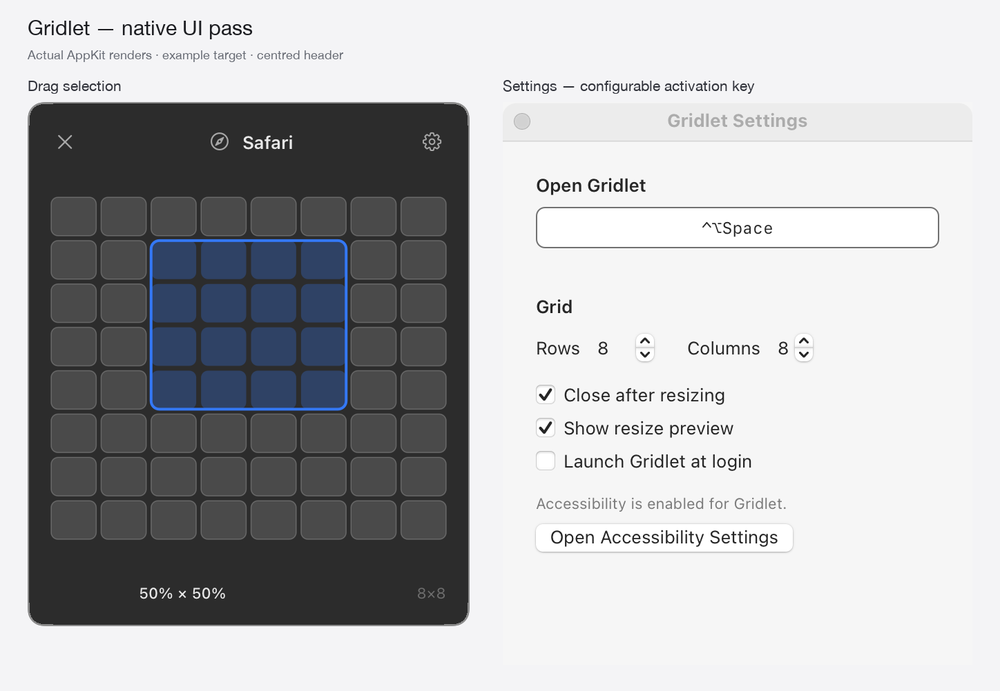

# Gridlet

**Alpha.** A tiny native macOS utility: hit your shortcut, drag a rectangle on a grid, and the window you were just using snaps to that portion of the screen.

No tiling-manager dashboards, no window rules, no config files. One grid, one gesture.

> Gridlet is an independent open-source project inspired by the *documented behaviour* of [Divvy](https://mizage.com/help/divvy/user_guide.html). It contains no Divvy code or assets, and is not affiliated with Mizage.



## Status: alpha

Working and used daily, but pre-1.0:

- Signed ad hoc, **not notarised** — macOS will warn on first launch (see [Install](#install)).
- Verified on macOS 15 (Apple Silicon) with one display. Multi-monitor placement is covered by unit tests, not by physical hardware testing.
- Accessibility behaviour differs per app; some windows enforce a minimum size (Gridlet gets as close as it can rather than refusing).

## Requirements

- macOS 13 or later
- Accessibility permission (Gridlet moves *other* apps' windows)

## Install

1. Download `Gridlet-0.2.2-macos.zip` from [Releases](../../releases/latest) and unzip it.
2. Move `Gridlet.app` to `/Applications` (or `~/Applications`).
3. First launch: **right-click → Open**. The build is ad hoc signed rather than notarised, so double-clicking may be blocked once. Do not disable Gatekeeper globally.
4. Enable Gridlet in **System Settings → Privacy & Security → Accessibility**.
5. If it still reports that access is needed, quit Gridlet and open it again (macOS caches the permission per process).

## Use

1. Set your shortcut in **Settings…** (default ⌃⌥Space).
2. Focus the window you want to move.
3. Press the shortcut — the grid appears on each display.
4. Click and drag across cells. Release, and the window takes that portion of the screen.

- **Esc** cancels and dismisses without moving anything.
- **Click outside** the panel dismisses it.
- Grid size is adjustable (1–12 rows/columns) in Settings; the default is **8×8**.

The menu-bar grid icon shows the same menu: status (Ready / Accessibility needed / Shortcut unavailable), **Show Grid**, **Settings…**, **Quit**. With a menu-bar manager (Ice, Bartender, etc.) the icon may be hidden — the shortcut still works.

## Settings

- **Open Gridlet** — the activation shortcut. Recorded with the keyboard; Esc cancels recording. If a combination is already taken, the previous shortcut stays active.
- **Rows / Columns** — grid resolution.
- **Close after resizing** — on by default; turn off to keep the grid open for several windows.
- **Show resize preview** — the blue overlay showing where the window will land.
- **Launch Gridlet at login** — off by default.

## Privacy

Gridlet has no networking code, no analytics, no accounts and no auto-updater. It reads window position/size through the macOS Accessibility API and writes new geometry back. Settings live in `UserDefaults` under `org.gridlet.Gridlet`.

## Build from source

```bash
git clone https://github.com/jollybully/gridlet.git
cd gridlet
./scripts/build.sh
```

Outputs `dist/Gridlet.app` and a versioned zip. `scripts/build.sh` runs the test suite, builds release, renders the app icon, ad hoc signs the bundle and runs a UI smoke gate.

Requirements: Xcode command-line tools with Swift 6 (developed with Swift 6.1 / Xcode 16.3).

### Tests

```bash
swift test                      # unit + UI-shell tests
./scripts/ui_smoke.sh           # panel launches; drag dispatch keeps panel stationary
./scripts/run_input_routing_regression.sh
```

`swift test` covers grid geometry (inclusive/reverse drags, cell clamping, multi-display coordinate conversion), header centring, best-effort sizing for minimum-size windows, preview overlay animation, hotkey binding validation/migration and the menu-bar readiness states.

### Diagnostics

```bash
dist/Gridlet.app/Contents/MacOS/Gridlet --diagnostics-json
```

Optional Accessibility resize smoke test against a **disposable** window you control:

```bash
dist/Gridlet.app/Contents/MacOS/Gridlet --smoke-test-target-pid PID --selection 8,8,0,0,3,3
```

Prints requested and actual AX frames. Exit is non-zero on a malformed selection.

**Experimental:** `--ui-snapshot out.png --snapshot-appearance dark --snapshot-state selected` renders the production panel in-process (no screen recording). `--snapshot-screen settings|permission` captures the standard windows. Composites can differ slightly from live material/vibrancy.

## Known limitations

- Not notarised; no Developer ID build is published.
- Minimum-size windows are moved as close to the requested cell as possible, not exactly.
- Full-screen windows, sheets, drawers and the desktop are deliberately ignored.
- Global shortcut conflicts can't be detected automatically; Gridlet keeps your previous working shortcut.
- No margins/gutters, no screen-cycling shortcuts, no preset layouts (by design — the mouse gesture is the product).
- Physical multi-monitor verification is still outstanding.

## License

MIT — see [LICENSE](LICENSE). You may use, modify and redistribute it, including commercially, provided the copyright notice is retained.
