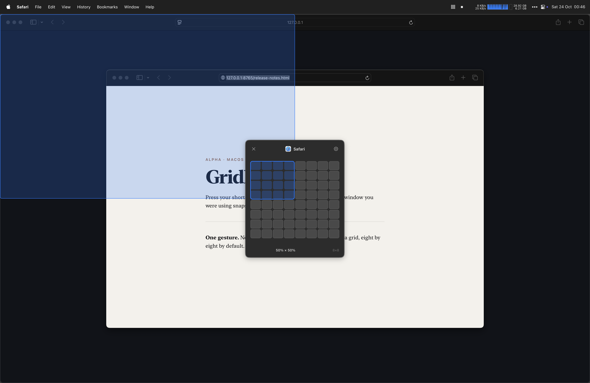

# Gridlet

A tiny macOS window manager. Press your shortcut, drag a rectangle on the grid, and the window you were using snaps to that part of the screen.

**Alpha** — works daily, but not notarised. Universal build, macOS 13+.



## Install

Apple Silicon or Intel, macOS 13 or newer.

1. Download the latest `Gridlet-<version>-macos.zip` from [Releases](../../releases/latest) and unzip it.
2. Move `Gridlet.app` to `/Applications` or `~/Applications`.
3. Right-click → **Open**. The build is not notarised, so a double-click is blocked as an unidentified developer.
4. Enable Gridlet in **System Settings → Privacy & Security → Accessibility**, then quit and reopen it. Without this it launches but cannot move windows.

## Use

Set your shortcut in **Settings…** (default ⌃⌥Space). Focus a window, press the shortcut, drag on the grid, release. **Esc** cancels.

The grid is a proportional map of the display, so half the columns by half the rows is exactly half the screen. Settings covers rows and columns (default 8×8), an edge gap of 0–24pt, and a different grid size per display when you have more than one screen.

## Build

```bash
git clone https://github.com/jollybully/gridlet.git && cd gridlet
./scripts/build.sh      # tests, release build, sign → dist/
```

`scripts/build.sh` signs with a **stable local identity** (`Gridlet Dev`, created on first
build by `scripts/dev-signing-identity.sh` in its own throwaway keychain). That matters:
an ad-hoc signature changes on every build, and macOS silently drops the Accessibility
grant when it does, so you would have to re-enable the app after each build. A
certificate keeps the same designated requirement, so the grant survives rebuilds. The
certificate is self-signed and is **not** added to any system trust settings — it exists
only to give builds a consistent identity. If creating it fails, the script falls back to
ad-hoc signing and prints a warning.

The script also adds that keychain to your login keychain search list so `codesign` can
find the identity without prompting.

## Notes

- No networking, analytics or accounts. Settings live in `UserDefaults`.
- Minimum-size windows are moved as close as possible rather than refused.
- Full-screen windows, sheets and the desktop are ignored.
- Not notarised: signed with a self-signed development certificate, so Gatekeeper asks
  you to confirm the first launch.

## Why it exists

I used [Divvy](https://mizage.com/divvy/) for years and loved it — one grid, one drag, done. It no longer works on recent macOS, so this is a from-scratch reimplementation of that workflow. No Divvy code or assets; all credit for the idea to its author. Not affiliated with Mizage.

MIT — see [LICENSE](LICENSE).
